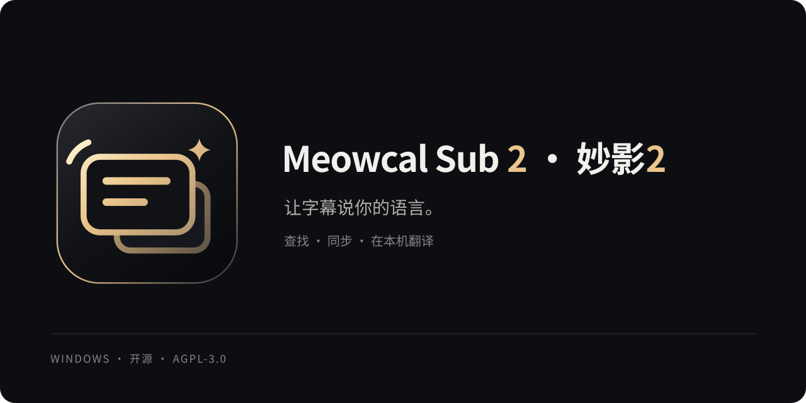

<p align="center">
  
</p>

<p align="center">
  
  <a href="LICENSE"></a>
</p>

<p align="center">
  <a href="https://github.com/PeterShanxin/Meowcal-Sub-2/releases/latest">下载</a> ·
  <a href="https://petershanxin.github.io/Meowcal-Sub/zh-CN/sub-2/">官网</a> ·
  <a href="README.md">English</a> ·
  <a href="docs/user-guide.zh-CN.md">用户指南</a> ·
  <a href="docs/developer-guide.md">从源代码构建（英文）</a>
</p>

妙影2（Meowcal Sub 2）是一款 Windows 桌面字幕工作室。它读取屏幕上的字幕区域，对照字幕文件跟上播放进度，并在一条始终置顶的字幕条中显示译文。找不到合适的译文时，它可以通过 [Meowcal Core](docs/MEOWCAL_CORE.md)（英文）在本机翻译。

## 功能

- 在一个工作室里搜索 **OpenSubtitles、SubDL 和 ASSRT**。
- 用文字识别（OCR）匹配播放器中显示的字幕，确定播放位置。
- 按译文字幕文件自己的时间、重叠和空档显示译文；没有覆盖的行可以使用原文字幕自带的译文或本地推理补上。
- 部分字幕已有译文时，可以在播放前补译缺失的行。在 main 分支上，只有原文也可以先看。应用边播边译，整份译好后会从当前位置自动跟播。观看时可通过实时控制栏调整字幕时间。
- 准备时自动给字幕排序并删除完全重复的行；原始文件保持不变。
- 同步前可以编辑 SRT/WebVTT 的文字和时间，预览偏移校正，并在已准备的会话中直接使用修正后的副本。
- 在应用内选择捕获区域，调整字幕外观。
- 在 `main` 分支上，界面可以使用英文或简体中文。默认跟随 Windows 显示语言，也可以在设置中选择。

文字识别和匹配效果取决于视频、字幕版本、语言和所选区域。这是早期版本，无法保证每个播放器和每部作品都能匹配成功。受保护的视频画面可能无法截取。

## 其他 Meow 项目

| 应用 | 工作方式 |
| --- | --- |
| [Meowcal Sub · 妙影](https://github.com/PeterShanxin/Meowcal-Sub) | 用本地 OCR 和推理直接翻译屏幕上的字幕；日常使用不需要字幕文件或字幕来源密钥。 |
| **Meowcal Sub 2 · 妙影2** | 搜索字幕来源，对照原文字幕跟上播放，显示译文文件中的字幕；缺失的部分由本地翻译补上。 |
| [MeowWatch](https://github.com/PeterShanxin/MeowWatch) | 和朋友一起看视频，播放同步，并有悬浮聊天。 |

## 开始使用

从 [Latest release](https://github.com/PeterShanxin/Meowcal-Sub-2/releases/latest) 下载安装包。Windows on ARM 选择 `arm64`，Intel/AMD 处理器的 Windows 选择 `x64`：

- **安装版：**`meowcal-sub-2-v*-windows-{arm64,x64}-setup.exe`。
- **便携版：**`meowcal-sub-2-v*-windows-{arm64,x64}-portable.zip`。请完整解压，然后打开文件夹中的 **Meowcal Sub 2.exe**。

两种安装包都包含 Python 后台和 Meowcal Core 可执行文件。模型在设置中安装。发布页同时提供 SHA-256 校验和。v0.1.0 和 v0.2.0 需要手动安装，才能升级到第一个已签名的版本。已签名的安装版之后可以在应用内更新；便携版需要手动更新。首次启动的设置方法见[用户指南](docs/user-guide.zh-CN.md)。

你需要 Windows 和 Microsoft WebView2。使用 Windows OCR 时，还需要屏幕上那种语言的 Windows OCR 语言包。从 v0.3.0 起，PP-OCRv6 无需 Windows OCR 语言包即可识别英语、中文、日语、西班牙语、法语和德语。搜索字幕至少需要一个字幕来源的凭据：OpenSubtitles API 密钥、SubDL API 密钥或 ASSRT 令牌。各来源的可用性和下载额度以其服务为准。

打开**设置**，配置一个字幕来源和语言组合。搜索片名，选择原文和译文字幕，然后选择**开始识别并同步**。拖动鼠标框住播放器的字幕，选择**确认**。看完后，在实时控制栏中选择**停止同步**。

本地翻译通过 Meowcal Core 使用腾讯混元翻译模型 HY-MT1.5。设置中提供一次性下载，约 **1.1 GB**，另加运行时。不需要安装 Sub 1。即使没有安装翻译模型，也可以使用已准备的译文字幕，只是缺失的行无法补译。

## 数据和网络

文字识别和翻译推理都在本机运行。搜索和下载字幕会连接已启用的字幕来源；可选的 TMDb 元数据、Google Fonts 以及引擎和模型的安装也会使用网络。配置、字幕文件和日志保存在用户目录中。普通日志使用 INFO 级别；只有明确开启详细模式时，才会记录详细的文字识别和字幕跟踪信息。日志中仍可能出现片名、错误信息等敏感内容，分享前请先删除。

工作室在 `127.0.0.1` 上提供本地页面，每次运行都需要访问令牌。这并不能隔离同一 Windows 账户下有访问权限的其他软件。详见[安全策略](SECURITY.md)（英文）。

## 文档

- [用户指南](docs/user-guide.zh-CN.md)：设置、观看流程、各项设置和故障排除。
- [播放时序图](docs/developer-guide.md#end-to-end-sequence)和[四种观看方式的流程图](docs/subtitle-fallback-design.md)（英文）。
- [开发者指南](docs/developer-guide.md)（英文）：从源代码搭建、运行模式、运行时约定、存储、发布和验证。
- [Meowcal Core](docs/MEOWCAL_CORE.md)（英文）：文字识别引擎、Core 协议和安装兼容性。
- 测试记录（英文）：[OCR 测量结果](docs/OCR_BENCHMARK.md)、[播放证据](docs/PLAYBACK_EVIDENCE.md)和[播放置信度校准](docs/PLAYING_CONFIDENCE_CALIBRATION.md)。

## 开发

应用由 Python 后台、React 工作室和 Tauri 外壳组成。搭建、构建和运行细节见[开发者指南](docs/developer-guide.md)（英文）。仓库的审查检查是：

```powershell
.\scripts\verify.ps1
```

这项检查覆盖代码和本地页面。原生文字识别、WebView2 渲染、捕获区域选择和字幕浮层位置仍需要在真实的 Windows 上运行验证。

## 许可证和贡献

妙影2 使用 **AGPL-3.0-only** 许可证，见 [LICENSE](LICENSE)。第三方组件和下载的模型各自保留原有许可证。贡献请遵循 [CONTRIBUTING.md](CONTRIBUTING.md)（英文）和基于提交的[贡献者许可协议](CLA.md)（英文）。
