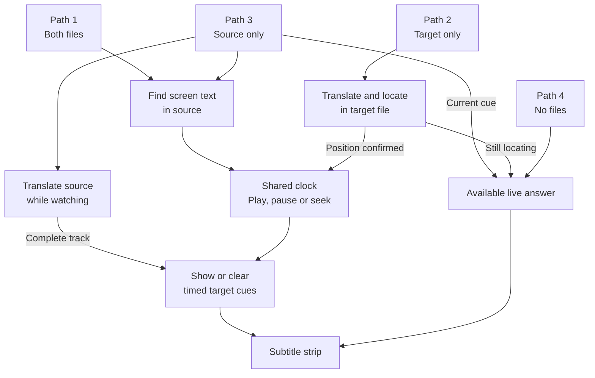
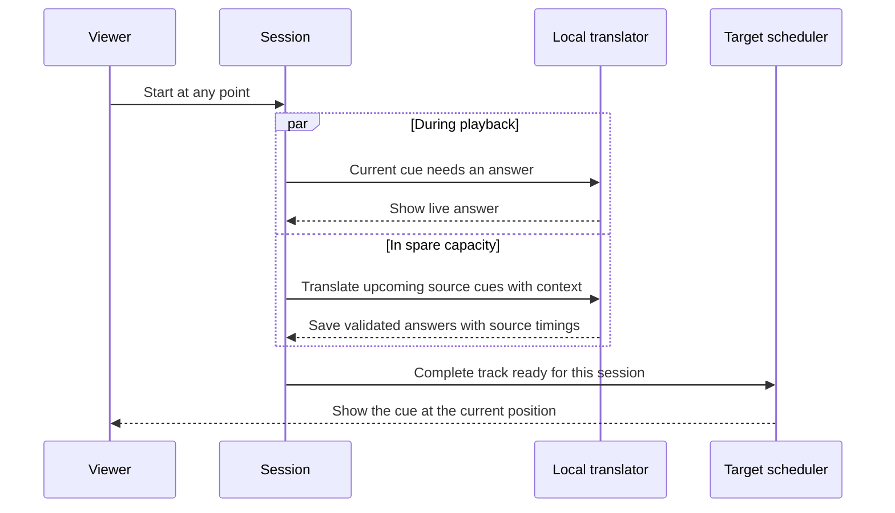

# Subtitle playback paths

These four names describe the files available when a viewer selects a movie or episode.
The **source** language is the writing visible in the player. The **target** is the
language the viewer wants on the strip. For example, English captions on a
Japanese soundtrack can be the source for a Chinese strip. The table describes
the current `main` branch. For the controls in each language, see the
[English guide](user-guide.md#choose-by-available-files) and [Chinese guide](user-guide.zh-CN.md).

| Path | Files at the start | How Sub 2 finds the scene | What the viewer sees |
| --- | --- | --- | --- |
| **Path 1 · Dual-track playback** (双轨跟播) | Source and target | Compare words read from the screen with the source file. Preparation checks how the two files' times relate. | After locating the scene, show each target cue at its scheduled time. |
| **Path 2 · Target-track playback** (译文跟播) | Target only | Translate screen captions and compare them with the target file. Several distinct cues must agree on a position. | Show available translations while searching. Once located, use the same timed display as Path 1. |
| **Path 3 · Source-track translation** (原文补译) | Source only | Locate the viewer in the source file. Generate a target track with the source cue times while the viewer watches. | Show current answers first. Once the whole track is ready, use Path 1's timed display at the viewer's current position. A bilingual source can already supply its own translations. |
| **Path 4 · Live screen translation** (屏幕直译) | Neither | Read each visible caption in the selected screen area. | Show the live translation. After a jump, the next readable dialogue supplies the next answer. |

## Where the paths meet

Search by title and choose the correct movie or episode. Sub 2 lists subtitle
files for the selected languages and prepares the viewer's selection. On Start,
select the part of the screen that contains the player's captions. From here
the app observes the picture while the viewer controls the original player.

**Two times to keep straight.** If preparation finds that target captions are
500 ms later than source captions, source time 12.0 seconds selects the target at
12.5 seconds. Without enough shared evidence, Path 1 starts with an unverified
offset of zero. Path 2 already locates the scene in target time. Path 3 gives
the generated captions the exact times of their source cues.

To locate a source cue, Sub 2 compares the words and tolerates small OCR
mistakes. When the optional meaning-based index is ready, it can also help
with weaker reads. For example, two lines may express the same idea using
different words. For Path 2 we tested an experimental direct cross-language
matcher on the same scenes as the installed translate-first method.

**Between screen reads.** Once located, the clock advances with observed playback,
and the strip can change at the next target boundary without a fresh screen caption.
A cue ending at 8:02 and the next starting at 8:04 leave two seconds of blank
strip. If two speakers' captions cover the same second, both appear. Screen
observations help the clock hold during a pause and find its place again after
a seek. The shared behavior is in the [clock](../src/meocosub2/timeline.py),
[cue selection](../src/meocosub2/presentation.py) and [playback loop](../src/meocosub2/sync.py).

## Follow a target file using screen observations

Path 2 keeps the first capture time when the next read confirms the same
words. The local translator supplies text to compare with the target file.
Two near-exact single-cue matches, or three qualifying matches with less
similar wording, can place the clock when their order and elapsed times agree.
Repeated wording can supply text for the strip. The clock needs evidence
from different cues to distinguish two appearances of the same phrase. While
locating, a late translation can supply a live answer and the next request
picks up the newest confirmed caption. Only a still-current answer supplies
timing evidence. Once following the file, the shared renderer owns the strip.

The position is already in target-file time. From here Paths 1 and 2 use
the same playback clock, capture observations, cue boundaries and strip
renderer. For example, if two speakers' lines overlap for one second,
both lines appear for that second. A pause where the target file has no text
keeps the strip empty. After evidence of a jump or capture loss, the strip
uses live answers while confirming the new position.
[Matching measurements and replay](target-track-replay.md).

## Build a target track while the viewer watches

On main, **Start** works as soon as the capture and translation engine are ready.
If the source clock knows the position, the engine translates the matching file
cue. While the app is looking for the position, it translates the screen text.
An existing bilingual source uses its own translations.

The app shares one local model. Watching gets priority over starting another
background cue. A live request can wait for one translation already in progress.
Skipping to another scene shifts the next background request to that part of
the file. The model sees neighboring source lines alongside their translations
when available. Waiting before pressing **Start** gives it a head start.

Each answer belongs to one source cue. Once all cues have an answer, the app
builds a separate in-memory target with their original start and end times.
Path 1's scheduler reads the completed target on the same clock, preserving a
pause or a moment with no text. The original file stays on disk as supplied.
Stopping keeps completed answers in the prepared session. Editing the file or
preparing another video gives the new session its own track. If the model
declines a line, live viewing continues. The implementation and local timing
measurements are in [PR #182](https://github.com/PeterShanxin/Meowcal-Sub-2/pull/182).

## Watching through both handoffs on the NUC

We supplied generated moving frames and a player region to the ordinary
playback loop on Windows x64. Windows OCR read the pixels and the installed
HY-MT model supplied the translations. The English captions changed every six
seconds. In the final scene the screen had no English caption to read.

| Watching path | What happened before the final scene | What reached the subtitle strip in the final scene |
| --- | --- | --- |
| Path 2 · Chinese file only | Live Chinese appeared at 1.12 s. At 13.55 s the clock was following the Chinese file. | The file scheduled a Chinese line at 36.0–39.5 s. The app sent it at 36.84 s and cleared it at 40.33 s. |
| Path 3 · English file only | Playback started 12 s into the source. The current translation arrived 1.25 s after starting. All seven source cues had translations by 6.72 s. | The app sent the generated final line 24.91 s after starting and cleared it at 28.41 s, without another English screen read. |

The stock renderer includes a 650 ms display delay. Times above are elapsed
wall-clock measurements at the strip's event output. Window discovery and
screen capture were supplied by the fixture. Desktop paint time and third-party
player behavior were outside this test. The [matched-scene comparison](target-track-replay.md)
and [live versus background model runs](https://github.com/PeterShanxin/Meowcal-Sub-2/pull/182)
cover different clips and loads.
