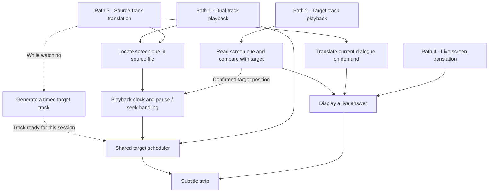
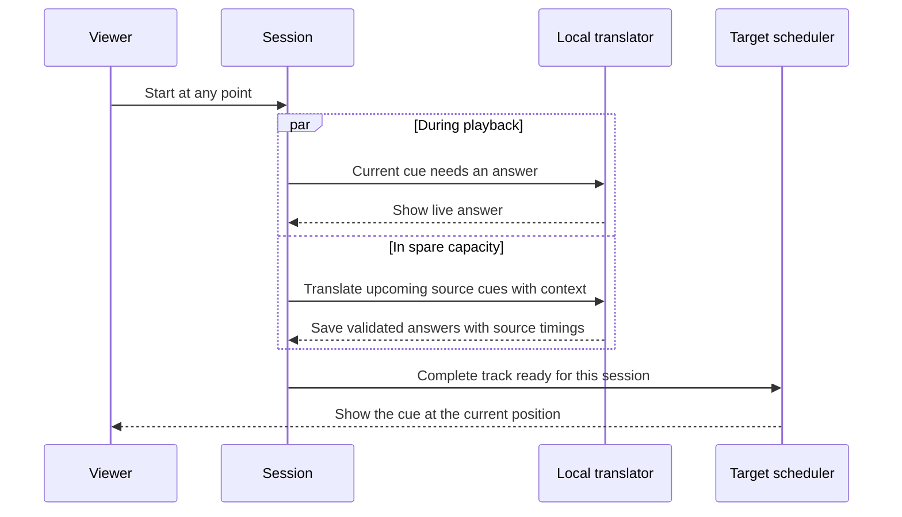

# Subtitle playback paths

The path names below describe what the viewer has when starting. The same
session can switch from a live answer to a timed subtitle without restarting
the video. The studio controls are listed in the [user guide](user-guide.md#choose-by-available-files).

| Path | Files at the start | Available today | Proposed addition |
| --- | --- | --- | --- |
| **Path 1 · Dual-track playback** (双轨跟播) | Source and target | Match screen text to source cues, then show target cues on their own schedule. | This is the reference for timed playback. |
| **Path 2 · Target-track playback** (译文跟播) | Target only | Compare translated screen reads with the target file. Once different cues agree on time, play the target file between reads. | See the [matching replay](target-track-replay.md) for tested limits. |
| **Path 3 · Source-track translation** (原文补译) | Source only | Show translations carried by the source. Translate wholly untranslated sources on demand. Partially answered sources can fill gaps ahead. | Start watching immediately and build a complete timed target track in the background. |
| **Path 4 · Live screen translation** (屏幕直译) | Neither | Translate readable on-screen captions as they appear after title selection. | This also supplies text while another path is waiting for a reliable position or translation. |

## Where the paths meet

The diagram shows the intended connections. Dashed arrows mark work still to
implement. The existing clock estimates the player's position, and the existing
target scheduler decides when text appears or clears. Path 2 joins Path 1 as soon as a target cue places the video. Path 3 uses the source clock while translating, then joins Path 1 at the target scheduler once its track is ready. Both components belong to the
[playback loop](../src/meocosub2/sync.py).

**Which clock?** With two files, map the source position to the target file
using the calibrated offset, or the unverified zero-offset default. With only a
target file, a reliable hit is already in target time. For a generated track,
copy the source intervals, so source and target time are equal. Applying the
two-file offset twice would move the subtitle away from the matched scene.

## Follow a target file using screen observations

Path 2 keeps the first capture time when the next read confirms the same
words. The local translator supplies text to compare with the target file.
Two near-exact single-cue matches, or three qualifying matches with less
similar wording, can place the clock when their order and elapsed times agree.
Repeated file wording can supply the displayed text. It cannot establish a
position by itself. A result for a caption that has changed or disappeared
cannot replace the current strip.

The position is already in target-file time. From here Paths 1 and 2 use
the same playback clock, capture observations, cue boundaries and strip
renderer. For example, if two speakers' lines overlap for one second,
both lines appear for that second. A pause where the target file has no text
keeps the strip empty. After evidence of a jump or capture loss, the strip
uses live answers while confirming the new position.
[Matching measurements and replay](target-track-replay.md).

## Build a target track while the viewer watches

Implementation is tracked in [Source-track translation, #165](https://github.com/PeterShanxin/Meowcal-Sub-2/issues/165).

When a monolingual source has no translation, **Start** should work as soon
as the live engine and capture are ready. Use the source clock when available
and translate the current dialogue on demand. While still locating the source,
use live screen translation. An existing bilingual translation takes precedence.

Prefer idle time on the installed engine as the first implementation. Give a
current cue priority and move queued background work when the viewer seeks.
A separate model process is an option if measurements show that it improves
completion time without delaying live subtitles or exhausting memory. Compare
live subtitle delay, total preparation time and peak memory on the same hardware.
A second process would need the same cancellation and shutdown guarantees as
the first. Waiting before pressing Start can give generation a head start.

Translate related cues together or provide neighboring dialogue when it helps
resolve names and pronouns. Preserve an answer for each source cue and check for
missing, duplicated or shifted answers. Keep accepted work separate from the
source file. On completion, attach the generated track at the **current**
position, including a blank interval or a paused frame. A late result from a
stopped, replaced or edited session must never take over the strip. A failed or
incomplete generation leaves live viewing available.
