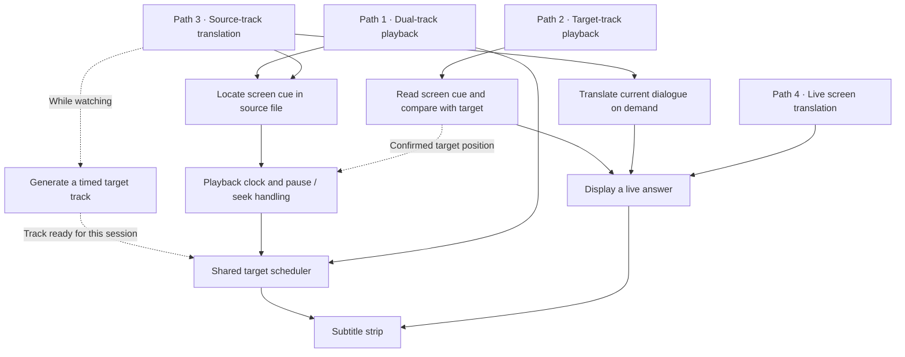
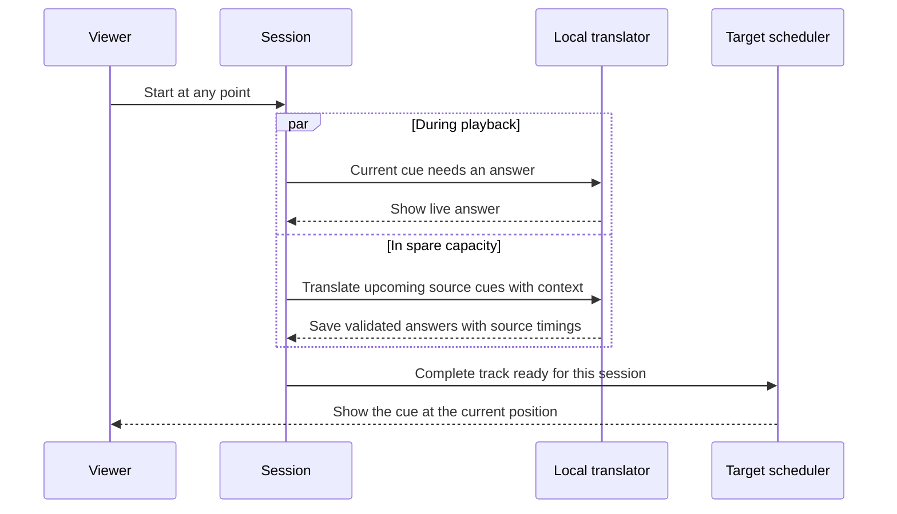

# Subtitle playback paths

The path names below describe what the viewer has when starting. The same
session can switch from a live answer to a timed subtitle without restarting
the video. The studio controls are listed in the [user guide](user-guide.md#choose-by-available-files).

| Path | Files at the start | Available today | Proposed addition |
| --- | --- | --- | --- |
| **Path 1 · Dual-track playback** (双轨跟播) | Source and target | Match screen text to source cues, then show target cues on their own schedule. | This is the reference for timed playback. |
| **Path 2 · Target-track playback** (译文跟播) | Target only | Translate OCR, compare the translation with the file, and use its wording on a hit. | Use a confirmed match to follow the target clock between reads. |
| **Path 3 · Source-track translation** (原文补译) | Source only | Show translations carried by the source. Translate wholly untranslated sources on demand. Partially answered sources can fill gaps ahead. | Start watching immediately and build a complete timed target track in the background. |
| **Path 4 · Live screen translation** (屏幕直译) | Neither | Translate readable on-screen captions as they appear after title selection. | This also supplies text while another path is waiting for a reliable position or translation. |

## Where the paths meet

The diagram shows the intended connections. Dashed arrows mark work still to
implement. The existing clock estimates the player's position, and the existing
target scheduler decides when text appears or clears. Path 2 joins Path 1 as soon as a target cue places the video. Path 3 uses the source clock while translating, then joins Path 1 at the target scheduler once its track is ready. Both components belong to the
[playback loop](../src/meocosub2/sync.py).

**Which clock?** With two files, map the source position to the target file
using the calibrated offset, or the unverified zero-offset default. With only a
target file, a reliable hit is already in target time. For a generated track,
copy the source intervals, so source and target time are equal. Applying the
two-file offset twice would move the subtitle away from the matched scene.

## Follow a target file using screen observations

Implementation is tracked in [Target-track playback, #164](https://github.com/PeterShanxin/Meowcal-Sub-2/issues/164).

Today `DirectTranslationSession.translate` returns the matched wording. The
match already contains a cue index and start time. The missing connection is to
retain its identity, the first capture time and the strength of the evidence.
A late model answer must refer to the moment the viewer saw the cue.

Use a short sequence of readings to distinguish two occurrences of “Thank you.”
A paused reread counts as the same cue. Compare translate-then-match, direct
multilingual matching and combinations on the same labeled scenes. Measure wrong
locks, correctly located scenes, time to first lock and time to recover after
a seek. Also measure when the *following* target cue actually appears.

Once the position is reliable, feed target time to the existing
[`PlaybackTimeline`](../src/meocosub2/timeline.py) and use the existing
[`PresentationTrack`](../src/meocosub2/presentation.py) and boundary renderer.
Carry the same motion, pause, seek and capture-loss evidence through that path.
If the clock loses its place, clear the old scheduled line, show live answers
when available and keep looking. A shared playback test should run both file
paths through two overlapping cues, silence, a pause in silence, a backward
seek and recovery. Only the way they establish the position should differ.

## Build a target track while the viewer watches

Implementation is tracked in [Source-track translation, #165](https://github.com/PeterShanxin/Meowcal-Sub-2/issues/165).

When a monolingual source has no translation, **Start** should work as soon
as the live engine and capture are ready. Use the source clock when available
and translate the current dialogue on demand. While still locating the source,
use live screen translation. An existing bilingual translation takes precedence.

Prefer idle time on the installed engine as the first implementation. Give a
current cue priority and move queued background work when the viewer seeks.
A separate model process is an option if measurements show that it improves
completion time without delaying live subtitles or exhausting memory. Compare
live subtitle delay, total preparation time and peak memory on the same hardware.
A second process would need the same cancellation and shutdown guarantees as
the first. Waiting before pressing Start can give generation a head start.

Translate related cues together or provide neighboring dialogue when it helps
resolve names and pronouns. Preserve an answer for each source cue and check for
missing, duplicated or shifted answers. Keep accepted work separate from the
source file. On completion, attach the generated track at the **current**
position, including a blank interval or a paused frame. A late result from a
stopped, replaced or edited session must never take over the strip. A failed or
incomplete generation leaves live viewing available.
