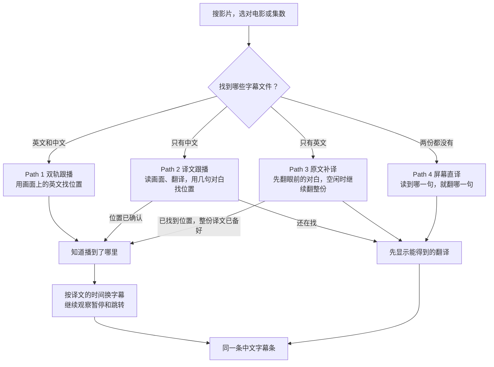

# 用户指南

[English](user-guide.md)

妙影2（Meowcal Sub 2）读取屏幕上选定区域内显示的字幕，并在一条始终置顶的字幕条中显示译文。原文字幕文件帮助它跟上播放进度；译文字幕文件提供人工翻译和它自己的显示时间。某一行没有人工翻译时，本地翻译引擎可以补上。没有匹配的原文字幕时，也可以直接翻译识别到的屏幕文字。

本指南适用于 v0.4.1。安装包和升级方法见[版本说明](releases/v0.4.1.zh-CN.md)。

## 安装与首次启动

在 Windows 11 上，可以通过 [Microsoft Store](https://apps.microsoft.com/detail/9NH782JNLWJP) 安装。商店自动匹配处理器架构，并管理应用更新。

也可以从 [GitHub 发布页](https://github.com/PeterShanxin/Meowcal-Sub-2/releases/latest) 下载与你的处理器架构匹配的 Windows 安装包。Windows on ARM 选择 `arm64`，Intel/AMD 处理器的 Windows 选择 `x64`。可以在 Windows **设置 → 系统 → 系统信息 → 系统类型**中查看架构。

运行 `meowcal-sub-2-v*-windows-{arm64,x64}-setup.exe`，为当前用户安装。也可以完整解压 `meowcal-sub-2-v*-windows-{arm64,x64}-portable.zip`，然后打开解压文件夹中的 **Meowcal Sub 2.exe**。请让 `backend` 和 `core` 文件夹保留在可执行文件旁边。各版本均包含 Python 和 Core 可执行文件；翻译模型需要在设置中另行安装。

各版本启动时都会检查更新，每天最多一次。也可以前往**设置 → 更新 → 检查更新**手动检查。商店版只检查 Microsoft Store，有可用更新时会提供打开商店的入口。通过 GitHub 已签名安装包安装的版本可在应用内选择**安装更新**。便携版发现适配当前电脑的新 ZIP 时，会打开 GitHub 发布页；请自行下载解压，应用不会替换文件。GitHub 的 v0.1.0 和 v0.2.0 需要先手动升级到 v0.2.1 或更高版本。

GitHub 发布页为每种架构提供一个 `meowcal-sub-2-v*-windows-{arm64,x64}-SHA256SUMS.txt` 文件，发布页还提供一份汇总的校验和列表。要在 PowerShell 中校验下载的安装包，请把下面命令的结果与对应条目比较：

```powershell
Get-FileHash .\meowcal-sub-2-v*-windows-arm64-portable.zip -Algorithm SHA256
```

从源代码运行的方法见[开发者指南](developer-guide.md)（英文）。

桌面应用需要 Microsoft WebView2。Windows OCR 需要屏幕上那种语言的 Windows 语言包。要添加语言包，请在 Windows **设置 → 时间和语言 → 语言和区域**中添加该语言；Windows 可能会要求管理员权限或重启。语言包安装完成后，请重启妙影2。

### 界面语言

界面可以显示为英文或简体中文。默认跟随 Windows 显示语言：Windows 显示语言为任意中文时显示简体中文，其他语言显示英文。要手动选择，请打开**设置 → 外观 → 界面语言**，选择**跟随系统**、**English** 或**简体中文**。更改立即生效，重启后仍然保留。选择**跟随系统**时，托盘菜单在工作室窗口加载完成之前显示英文。

字幕、片名和文件名不会被翻译。应用无法识别的字幕来源或系统错误会按原文显示。

### 字幕来源

要搜索字幕文件，请打开**设置 → 字幕来源**，至少启用一个来源：

| 来源 | 凭据 |
| --- | --- |
| OpenSubtitles | **API 密钥**；该服务要求时还需要**用户名**和**密码** |
| SubDL | **API 密钥** |
| ASSRT | **令牌** |

每个来源都有**已启用**/**已停用**开关。已启用但没有凭据的来源会被跳过，搜索界面会显示提示，例如“缺少 OpenSubtitles 密钥”。不用的来源请停用。字幕覆盖范围、服务可用性和下载额度取决于各个来源。OpenSubtitles 限制每天的下载次数；应用不会把最后两次剩余下载用在比较其他译文文件上。

**TMDb 跨语言合并**配合 **TMDb API 密钥**，可以把不同语言名称的同一部作品合并为一项。TMDb 不是字幕来源。

### 语言

搜索框旁的两个语言按钮显示原文和译文的语言代码，例如 `ZH → EN`。原文语言是播放器中显示的字幕语言；译文语言是你想看的语言。中文有两个选项：**简体中文**（`zh`）和**繁体中文**（`zht`）。如果选择另一侧已经在用的语言，两种语言会互换。更改语言会清除当前选择，并重新运行上一次搜索。

文字识别语言跟随原文语言，可以在**设置 → 画面捕获 → 文字识别语言**中查看。

### 本地翻译

打开**设置 → 翻译**，选择**下载翻译引擎**。这会下载约 1.1 GB 的模型数据和运行时。下载失败时，请选择**重新下载**。Meowcal Core 会校验翻译引擎，并把它与应用分开存放。GitHub 版可以导入早先的 Meowcal 安装中经过校验且版本匹配的文件。不需要安装 Sub 1。

没有翻译引擎时，以下会话仍可使用：

- 原文字幕文件加译文字幕文件；
- 自带译文的原文字幕文件。

此时工作室会显示提示“本地翻译尚未安装。匹配成功后仍可显示人工字幕，但无法补译缺失的行。请在设置中安装。”以下选项需要翻译引擎：**本地翻译**、**仅用文字识别**和**识别屏幕文字**。

在 main 分支上，单语原文选**本地翻译**后，会话就绪就可以开始看。应用优先翻译眼前这句，空闲时继续翻其他行。整份译完后，字幕条会自动按原文的时间显示译文；即使你暂停了或跳到了后半集，也会从当前位置接上。停止后重新启动同一个已准备好的会话，已经翻好的字幕仍然可用。

## 边看边显示字幕

1. 在播放器中开始播放视频，然后打开妙影2。
2. 搜索片名。选择电影，或者选择剧集、季和集。选择某一集时，应用会为这一集再做一次精确搜索，可能会增加字幕版本；片名搜索的结果仍然保留。
3. 打开**选择原文字幕**，再打开**选择译文字幕**。按[可用的字幕文件](#按可用的字幕文件选择)选择。原文语言要与播放器上看得见的字幕一致，即使视频配音是另一种语言。
4. 工作室显示**正在准备**时请稍候。出现**会话已就绪**后，检查**原文**、**译文**、**行数**和**覆盖**各行。不同的发布版本时间轴可能不同。展开**字幕已自动检查**，可以查看准备过程做了哪些调整。
5. 选择**开始识别并同步**（或按 Ctrl+Enter）。屏幕上会打开捕获区域选择器。拖动鼠标框住播放器的字幕区域，然后选择**确认**。如果播放器在另一块屏幕上，选择**切换显示器**；选择**取消**则返回且不开始。
6. 工作室会变成字幕条和一个实时控制栏。继续用原来的播放器播放、暂停或跳转。跟着字幕文件播放时，妙影2 会用画面上的对白核对位置。两份文件都没有时，就翻译接下来读到的屏幕文字。
7. 看完后，在控制栏中选择**停止同步**。已准备的会话会保留，可以再次开始。

每次开始都会要求选择捕获区域。请框住完整的字幕行，不要包含播放器控件和其他文字。让妙影2 的字幕条和控制栏留在区域之外，以免文字识别读到应用自己显示的译文。

关闭工作室窗口会停止会话并退出应用。托盘菜单中的**退出**效果相同。

用键盘选择时，可以在搜索框中使用方向键和 Enter，也可以按 Tab 移到片名、季、集或字幕结果上，再按 Enter 或空格。方向键会在结果按钮之间移动焦点。展开和选中的结果会向辅助技术报告状态，选中一个结果后焦点会回到搜索框，方便进行下一步。面板以外的方向键保持原有行为。

### 选择字幕文件

在 main 分支上，准备期间改选字幕会保留最新的选择。在同一次搜索中，检查原文和准备播放会共用同一次下载。

- **发布版本。**优先选择文件名与你的视频是同一发布版本的文件（例如同一个流媒体来源或光盘）。不同剪辑版本的文件可能会逐渐偏移或跳行。
- **语言标签。**每个文件的行会显示它的语言和格式。一个字幕包里有多个文件时，每个文件单独列出。标有两种语言的文件（例如中文和英文）是双语字幕，会同时出现在两个列表中。混合字幕包中没有语言标签的文件可能出现在两个列表中；请打开文件名确认。
- **双语原文。**所选原文字幕带有译文时，译文列表会把**原文字幕自带的译文**放在第一位。它的时间完全一致，也不需要下载。
- **更合适的译文。**准备完成后，卡片可能会推荐另一个能覆盖更多行的译文文件。选择**改用它**，即用那个文件重新准备。
- **译文时间轴尚未核实。**这条提示表示两份字幕中没有足够一致的人工字幕文本来确认原文和译文使用同一时间轴。请留意开头几分钟，必要时在编辑器中修正译文文件。

### 按可用的字幕文件选择

选好电影或剧集后，根据手里的字幕文件按下表选择。

| 观看方式 | 原文文件 | 译文文件 | 在工作室里怎么选 | 观看时会看到什么 |
| --- | --- | --- | --- | --- |
| Path 1 · 双轨跟播 | 有 | 有 | 依次选择两个文件，尽量选同一剪辑版本。 | 屏幕文字与原文匹配后，字幕条按译文文件的起止时间显示。原文的一句话可以对应先后出现的两条译文，两句之间没有对白的那几秒，字幕条也是空的。 |
| Path 2 · 译文跟播 | 无 | 有 | 选**识别屏幕文字**，再选译文文件。 | 字幕条先翻译屏幕上的字。连续几句都指向同一段剧情后，它就按译文文件的时间往下播，屏幕上有一句没认出来也能接着显示。跳到别处后，它会重新找位置，这时先显示能译出来的对白。 |
| Path 3 · 原文补译 | 有 | 无 | 双语文件可选**原文字幕自带的译文**。单语文件选**本地翻译**。 | 自带译文跟随原文时间。只有原文也能先看。应用先翻眼前的一句，空闲时翻其他行。整份译好后，Path 1 会从你正在看的位置接着显示。 |
| Path 4 · 屏幕直译 | 无 | 无 | 选**识别屏幕文字**，再选**仅用文字识别**。 | 本地引擎实时翻译框内可读的文字。在主分支的版本中，字幕按识别顺序显示，迟到的译文也会留出阅读时间；积压过多时会跳过旧句。跳转后也要等新位置出现文字。 |

两种无原文文件的方式都需要本地翻译引擎。框内的片头字卡、标牌等也可能被当作字幕翻译。如果还没设置字幕来源，或者搜不到片名，在搜索面板选择**翻译屏幕上的字幕**，再点**开始识别并同步**。

### 四条路怎样接在一起

以看英文对白、读中文字幕为例。「原文」是播放器画面里能读到的英文，「译文」是想在字幕条上看到的中文。



假设上一句中文在 **8:02** 结束，下一句从 **8:04** 开始。按时间跟播时，中间这两秒字幕条为空。按下暂停，字幕也应停在同一处；拖到第 20 分钟后，应用会用新画面重新找位置。两个人同时说话、文件里同时有两句有效字幕时，两句一起显示。

### 没有结果和来源失败

| 你看到的内容 | 含义 | 处理方法 |
| --- | --- | --- |
| `没有找到“…”` | 搜索已完成，但已启用的来源都没有返回结果 | 换一种拼写、使用原始片名，或换另一种语言搜索。没有结果并不代表这部作品没有字幕。 |
| `没有结果：搜索未完成`，并带有提示 | 所有运行的来源都失败了 | 阅读提示，其中列出了每个来源的错误。 |
| “所有字幕来源都已关闭。请在设置中启用至少一个。” | 没有启用任何来源 | 在**设置 → 字幕来源**中启用一个来源。 |
| “缺少 SubDL 密钥”或“ASSRT 已停用，中文字幕可能较少。”之类的提示 | 有来源被跳过 | 如果需要，请补充凭据或启用该来源。 |
| 有结果，同时带有提示 | 部分来源失败，其他来源正常返回 | 正常来源返回的结果可以使用。 |
| `这一集没有字幕` | 当前打开的原文或译文列表中没有这一集的文件 | 换一集、检查语言组合，或者使用列表中的备用选项。 |

## 文字识别引擎

**设置 → 画面捕获 → 文字识别引擎**有三个选项。选择在会话开始时生效。

- **自动**：已安装完全匹配的 Windows 语言包时使用 Windows OCR。否则，英语、中文、日语、西班牙语、法语和德语使用 PP-OCRv6。没有原文文件的会话也接受已安装的兼容 Windows 语言包，例如用简体中文语言包识别繁体中文，因为 PP-OCRv6 会读到更多画面中的文字。
- **Windows OCR**：始终使用 Windows OCR 及其语言包。
- **PP-OCRv6**：上述语言使用 PP-OCRv6。韩语始终使用 Windows OCR。

PP-OCRv6 包含在 Core 中，不需要 Windows 语言包。在记录的测试中，它识别文字比 Windows OCR 更准确，但显示出的字幕行并没有更多，而且每一帧耗时更长、CPU 占用更高（见 [OCR 测量结果](OCR_BENCHMARK.md)，英文）。

如果 Core 中没有 PP-OCRv6、PP-OCRv6 无法启动，或者不支持该语言，会话会改用 Windows OCR，并显示说明这一点的提醒。改用了其他 Windows 语言包时也会提醒。事件日志会记录实际使用的引擎（`ocr.engine.ready`）。如果 Windows OCR 也没有可用的语言包，开始会被中止，提示会写明缺少哪个语言包。

## 同步前修正字幕

在**会话已就绪**时，选择**编辑字幕**。工作区会打开已准备的原文和译文文件；在自动选择模式下也包括原文候选文件。编辑前请先停止正在运行的会话。

- 选择一条字幕轨，再选择一条字幕。修改它的文字或开始/结束时间，然后选择**保留修改**。时间使用整数毫秒：1000 毫秒等于 1 秒。
- **整体平移所有字幕**用于修正固定的延迟。负数让字幕提前，正数让字幕延后。
- **对齐两个时间点**用于修正逐渐累积的偏差。为一条靠前和一条靠后的字幕分别输入字幕时间和视频时间。两组时间都必须随时间递增。
- 选择**预览时间**，检查修改前后的两列时间，然后选择**应用时间**。预览期间也可以翻页和按字幕编号跳转。工作区打开期间，每条字幕轨会各自保留时间设置和最多 50 步撤销。
- **导入替换文件**把本地的 UTF-8 SRT 或 WebVTT 文件载入所选字幕轨。**导出副本**下载当前修正后的文件，不改变会话。
- **保存并使用**把修改过的字幕轨另存为新文件，并重建已准备的会话。播放偏移会重置为 0 毫秒；开始同步即可使用修正后的字幕轨。

空字幕、无效的时间段或无法安全编码的文字等错误会阻止保存。重叠、重复和顺序错乱属于警告，因为其中有些是有意为之。不支持的 WebVTT 结构（包括 STYLE 和 REGION 块）会被拒绝，而不是被丢弃。受支持的注释、字幕标识、设置和文字都会保留；输出使用 LF 换行和连续的 SRT 编号。文件必须是 UTF-8 编码，且不超过 4 MiB。

保存失败时，新副本会被删除，之前准备好的会话保持不变。请修正提示的问题后再次保存。原始文件不会被改动。GitHub 版的修正后会话副本存放在 `%APPDATA%\meowcal-sub-2\subtitles\corrected`；Microsoft Store 版则存放在下文所述商店数据目录中的 `meowcal-sub-2\subtitles\corrected`。如果想把副本保存到其他位置或导入另一个会话，请导出副本。

## 观看时调整

实时控制栏有以下控件：

- **选区**：在不结束会话的情况下重新选择捕获区域。移动播放器或更换显示器后使用。
- **设置**：修改画面捕获、语言和字幕外观等选项。
- **+** 让字幕提前显示，**−** 让字幕延后显示。请小步调整，并观察接下来的几行字幕。时间调整无法修复来自不同剪辑版本的文件。
- **停止同步**：结束会话。

会话有提醒时（例如文字识别引擎改用了其他引擎），控制栏收起时的圆点会变成 **!**，展开后也会有一个 **!** 按钮。这个按钮会把控件换成提醒文字；再次选择即可回到控件。选择**停止同步**后，提醒会继续显示在已准备的会话界面上，直到之后的搜索、准备、字幕保存、开始或错误替换它。

跟着字幕文件播放时，应用会观察画面变化；能确定声音来自播放器时，也会参考声音。确认暂停后，字幕条停在同一处。假如暂停时正好没人说话，字幕条就继续留空。跳转后，可能要看到几句不同的对白才能找到新位置。找不到原来的位置时，应用会清除旧字幕；本地翻译可用时，先显示眼前对白的译文。

有的电影会把一句字幕放到画面上方。如果你框选的是底部，这一刻可能读不到字。只要之前已经对上字幕文件，画面又在持续变化，字幕条就能按时间显示下一句。在 Edge 里，声音可以辅助判断；光靠其他标签页发出的声音，字幕不会继续往下走。两份字幕文件都没有时，实时翻译要等选框内出现能读到的字。

## 存储的数据和网络连接

GitHub 版的配置文件位于 `%APPDATA%\meowcal-sub-2\config.toml`。[config.example.toml](../config.example.toml) 展示了配置格式；通常通过设置修改即可。更改工作室端口需要重启。下载的字幕缓存在 `%USERPROFILE%\.cache\meowcal-sub-2`。

Microsoft Store 版独立保存设置、凭据、字幕缓存、模型和 WebView 数据，根目录为 `%LOCALAPPDATA%\Packages\ShanxinLi.MeowcalSub2_hs4jcn39rmtjt\LocalState`。从 GitHub 版切换时，请重新填写字幕来源凭据。商店版默认端口为 8766，GitHub 版为 8765。

文字识别和本地翻译推理都在本机运行。已启用的字幕来源会收到搜索和下载请求。可选的 TMDb 查询、来自 Google Fonts 的工作室字体，以及运行时和模型的安装也会使用网络。

## 日志和诊断

GitHub 版的日志位于 `%APPDATA%\meowcal-sub-2\logs`；Microsoft Store 版的日志位于商店数据目录中的 `meowcal-sub-2\logs`：

- `meowcal-sub-2.log` 以 INFO 级别记录应用运行情况。每天新建一个文件，保留之前的七个文件。
- `meowcal-sub-2.events.jsonl` 记录应用事件，每行一条。文件达到 5 MiB 时会改名为 `meowcal-sub-2.events.jsonl.1`，并替换之前的那个文件。

事件日志会去掉类似凭据的值和 URL 查询参数，但两种日志都可能包含片名、搜索词、文件名和错误文字。包含识别文字和字幕内容的详细文字识别与字幕跟踪信息，只有在开发者以详细模式运行后台时才会写入。

**设置 → 调试 → 把每次捕获的文字识别诊断信息（包括识别出的文字）发送给开发者工具**会通过工作室连接发送每次捕获的时间和匹配数据。工作室不会显示这些数据，日志文件也不会因此记录更多内容。

不要分享原始日志、字幕来源凭据、带令牌的工作室网址，或者私人观看内容的截图。

## 卸载

在 Windows **设置 → 应用**中卸载 Microsoft Store 版。Windows 会移除该版本的本地应用包数据。请先导出要保留的修正后字幕。

在 Windows **设置 → 应用**中卸载 GitHub 安装版。勾选 **Delete the application data** 可以同时删除下面列出的文件夹。早期版本把翻译引擎放在 `%LOCALAPPDATA%\Meowcal\Core\production`，Meowcal Sub（妙影）也会使用这个位置；只有在这台电脑从未运行过 Meowcal Sub 时，卸载程序才会删除它。

便携版没有卸载程序。请关闭应用，删除解压出的文件夹，然后删除以下文件夹：

| 文件夹 | 内容 |
| --- | --- |
| `%APPDATA%\meowcal-sub-2` | 配置、日志、修正后的字幕 |
| `%USERPROFILE%\.cache\meowcal-sub-2` | 下载的字幕 |
| `%LOCALAPPDATA%\com.meowcal.sub2` | 语义匹配模型、WebView 数据 |
| `%LOCALAPPDATA%\Meowcal\Core\sub2` | 翻译引擎 |

如果你不使用 Meowcal Sub，也请删除 `%LOCALAPPDATA%\Meowcal\Core\production`。

## 故障排除

### 搜索没有结果或来源失败

参考[没有结果和来源失败](#没有结果和来源失败)中的表格。检查该来源的开关和凭据、片名和语言组合、网络连接，以及该来源的下载额度。

### 下载失败

如果 ASSRT 提示“ASSRT 已不再提供所选文件，请重新搜索。”，请重新搜索并再次选择该文件。如果来源提示下载额度已用完，请从其他来源选择文件，或者等待额度恢复。

### 准备时出错停止

针对某个文件的错误（例如“第 12 条字幕的时间无效”）表示该文件无法安全播放。请换一个文件，或者修正文件后用字幕编辑器导入。如果错误与翻译引擎有关，请在**设置 → 翻译**中安装，或者选择一个译文文件。

### 没有字幕出现，或识别出的文字不对

选择**选区**，检查选框是否包含完整的播放器字幕。检查原文语言和**文字识别引擎**设置。使用 Windows OCR 时，确认 Windows 中该语言包显示为已安装。不要把播放器控件或妙影2 的字幕条框进去。受保护的播放画面可能无法捕获；文字识别无法读取空白或全黑的画面。

### 字幕偏移或显示了错误的行

检查所选的集数和发布版本。固定的延迟可以尝试小幅调整时间。对于不同剪辑版本的视频，请换一个原文或译文文件。不要通过降低匹配阈值来强行匹配不相关的对白。

### 无法翻译

在**设置 → 翻译**中查看安装进度或错误。如果引擎下载失败，请重新下载。翻译速度取决于电脑性能；超时或未通过校验的译文不会显示。

### 应用无法启动，或显示旧的界面

通过托盘菜单中的**退出**关闭应用，然后重新打开。如果问题依旧，请先重启 Windows 再报告问题。

## 报告问题

对于可以重现的应用问题，请[提交 issue](https://github.com/PeterShanxin/Meowcal-Sub-2/issues)。请写明：

- 应用版本：见**设置 → 更新**，或你安装的发布版本；
- 你使用的是 Microsoft Store 版、GitHub 安装版、便携版还是源代码构建；
- Windows 版本和架构；
- 操作步骤、文字识别引擎设置，以及启用了哪些来源；
- 完整的错误文字，并去掉片名和个人信息。

不要附上私人字幕对白、观看截图、原始日志、凭据或令牌。如果需要日志片段，只复制相关的几行，并去掉片名、文件名、识别出的文字和包含你用户名的路径。
